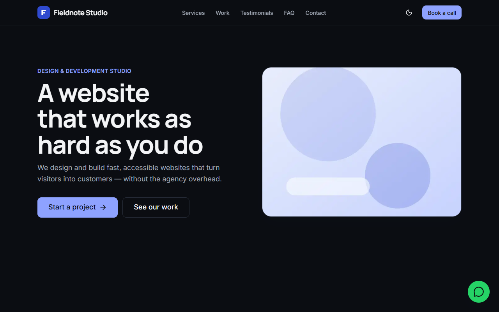

# Site Starter

A clean, accessible Next.js starter that every site template in this family is cloned from. Rebrand it by editing two files.



**Live demo:** https://site-starter.vercel.app <!-- TODO: replace with your deployment URL -->

## Features
- **Config-driven content**: every name, line of copy, image, link and contact detail lives in `src/config/site.config.ts`
- **Design tokens**: colors, fonts, radius and spacing come only from `src/styles/tokens.css`, with light and dark themes
- **Sections ready to compose**: Navbar (sticky, mobile menu with focus trap), Hero, LogoStrip, FeatureGrid, StatsRow, Gallery (lightbox), Testimonials, FAQ, CTABand, ContactForm, Footer, WhatsApp button
- **UI kit**: Button, Card, Badge, Heading, Field, Input, Select, Textarea, Icon and more, previewed at `/styleguide`
- **Theme toggle** that remembers each visitor's choice and defaults to the system setting
- **Contact form** with client validation and a server action stub, ready for Resend or Formspree
- **SEO**: metadata and Open Graph from config, `sitemap.xml`, `robots.txt`, custom 404
- **Accessible**: semantic landmarks, skip link, visible focus, AA contrast in both themes, scroll reveal that turns off with reduced motion
- **Fast**: Lighthouse 93+ mobile and 100 desktop for performance, 100 for accessibility, best practices and SEO; no layout shift

## Stack
Next.js 16 (App Router) · React 19 · TypeScript · Tailwind CSS v4 · next-themes · lucide-react · Vercel

## Getting started
```bash
npm install
npm run dev
```
Open http://localhost:3000. Other scripts: `npm run lint`, `npm run build`, `npm run start`.

## Customize in 3 steps
1. **Tokens**: set your colors (light and dark), radius and spacing in `src/styles/tokens.css`, and swap fonts in `src/styles/fonts.ts`.
2. **Config**: replace the demo business in `src/config/site.config.ts` (brand, nav, sections, contact, socials, SEO and `siteUrl`).
3. **Images**: drop your files into `public/images/` (logo, hero, gallery, avatars, `og.jpg` at 1200×630) and point the config at them.

To deliver contact form messages, fill in the `TODO` in `src/components/sections/contact.action.ts`.

## Deploy
[](https://vercel.com/new/clone?repository-url=https://github.com/biteforce-aj/site-starter)

Or import the repo at [vercel.com/new](https://vercel.com/new). No environment variables are needed until you connect an email service.

## License
MIT. See [LICENSE](LICENSE).
